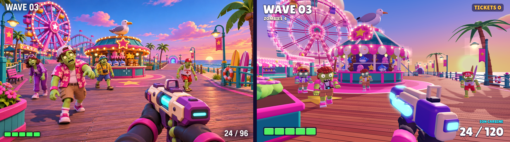

# What Lies Ahead

A single-player, first-person arcade zombie survival game made with Godot 4.

Five worlds, each one level: hold the ground around a loadout station through six or
seven waves (rushes, sieges, ambushes, bounties, a twist and a named alpha boss at the
end), spend tickets between waves, then follow the exit lights to the portal and step
through. Clearing a level unlocks the next world. Every zombie carries a stolen **Spark**;
pop it and you bank it, and Sparks buy the best skins, sights, cells, gloves and more in
the **Shop**. New players start in **Boot Camp**, a short, skippable tutorial.

| # | World | Level | Setting | New enemies |
| --- | --- | --- | --- | --- |
| 1 | Boardwalk Breakout | Prize Pier | Sunset amusement pier | Tourist Shambler, Lifeguard Runner, Boardwalk Bruiser |
| 2 | Neon Rooftops | Neon Skyline | Rainy rooftops above an arcade city, at night | Neon Punk, Hover Courier, Riot Bruiser |
| 3 | Abyss Aquarium | Tidal Tunnels | After-hours aquarium: glass tunnels, tanks and a kelp atrium | Deep Diver, Mascot Inker, Jelly Head |
| 4 | Dune Spaceport | Launch Pad 9 | Golden-hour desert spaceport around a rocket on its launch mount | Space Cadet, Jetpack Mechanic, Irradiated Hazmat |
| 5 | Frostpeak Resort | Summit Lodge | Twilight ski resort under the aurora | Ski Racer, Yeti, Frozen Tourist |



## Launching

**From the editor (recommended while developing)**

1. Install **Godot 4.7.1** (standard build, not .NET). Any 4.7.x should work.
2. Open Godot, choose **Import**, and select `project.godot` in this folder.
   The first open imports the assets, which takes a few minutes.
3. Press **F5** (Run Project). The game opens with its startup sequence, then the menu.
   On a fresh save it welcomes you and offers the Boot Camp tutorial.

The project uses the **Compatibility (OpenGL)** renderer, the lightest desktop option.

**From a build**: zipped builds are in [`builds/`](builds/).

| File | Platform | Status |
| --- | --- | --- |
| `WhatLiesAhead-linux-x86_64.zip` | Linux x86_64 | Smoke-tested (see *Verification*) |
| `WhatLiesAhead-windows-x86_64.zip` | Windows x86_64 | Exported, **not run** (no Windows machine here) |

Unzip and run the single executable. On Linux you may need `chmod +x WhatLiesAhead.x86_64`.
The Windows build is unsigned, so SmartScreen may ask for confirmation.

## Controls

| Action | Input |
| --- | --- |
| Move | W A S D |
| Look | Mouse |
| Sprint (forward) | Shift |
| Jump | Space (grace period after leaving a ledge, buffered presses; release early for a short hop) |
| Mantle / vault | Jump while pushing at a ledge 0.45–1.25 m high to climb onto it; at a run, thin obstacles up to 1.1 m are vaulted |
| Slide | C or Ctrl while sprinting (or as you land); a speed boost that follows slopes and tires when chained; jump out to keep its speed |
| Dash | V or the mouse's back button, on the ground: a quick burst toward the keys you hold (forward with none), every 1.2 s |
| Fire | Left mouse button |
| Aim down sights | Right mouse button (hold, or toggle in Settings) |
| Reload | R |
| Switch weapon | 1 / 2, or the mouse wheel |
| Start the next wave early | F |
| At the loadout station: energy top-up / snack heal | E / Q |
| At the loadout station: overshield / damage boost | G / B |
| At the loadout station: swap the held weapon | Z / X (or ← / →) |
| Pause | Esc or P |

All of these are Godot InputMap actions (*Project → Project Settings → Input Map*); the
station swap and purchase actions and the dash are added at start-up (`scripts/weapons/loadout.gd`,
`RunDirector.ensure_station_actions()`, `Player.ensure_dash_action()`) if the project does not define them. Curbs up to
0.3 m are stepped over without jumping. **Settings** (main menu or pause menu) has look
sensitivity (1.00 = 34 cm per 360° at 800 DPI, the same at any window size), aim
sensitivity, hold or toggle aim, invert look Y, field of view (vertical), reticle style and
colour, optic reticle colour, gameplay tips, master, music, effects and
ambience volume, camera motion, camera shake, flashes, a High/Low graphics preset and
fullscreen.

## How a run works

- **Preparation → Wave → Break → … → Extraction**, with **Defeat** reachable from any wave.
  Prize Pier has 6 waves, the other worlds 7; a run takes about 6–9 minutes.
- **Difficulty** (chosen on the Play page): **Casual** (weaker, slower enemies, health
  back at every wave clear, 80% rewards), **Standard**, or **Hard** (more, faster and
  angrier, 130% rewards). The score is never scaled.
- **Rounds with a purpose.** Each wave has a kind and a name on its banner: standard,
  rush, siege (heavies first), ambush (every entrance at once), ranged, a **bounty**
  (a golden runner that flees with a ticket prize), a world **twist** (Jackpot double
  tickets, Blackout, Frenzy, Low Gravity, Whiteout) and a **finale** against the world's
  named alpha (Big Bruno, Captain Lockdown, Inky the Great, Chief Burnout, Old
  Frostbite) with its own health bar and slam. Surges announce the entrance a pack is
  coming from. Each wave is graded S/A/B/C by the health it cost, and the grade pays
  tickets. Full design: **[docs/ROUNDS.md](docs/ROUNDS.md)**.
- **Checkpoint.** Clearing wave 3 reaches the checkpoint: lose on wave 4 or later and the
  results screen offers **Continue** from wave 4 (full health, some tickets, 75% rewards).
- **Two weapons.** You carry a primary and a secondary (chosen in the **Arsenal**). Each
  keeps its own ammo for the whole run. Switching cancels a reload.
- **The loadout station** (each world has its own, with a tall beacon; a waypoint points
  to it during breaks) sells an energy top-up for both weapons, one heal per break (a
  boardwalk snack, a noodle cup, fish & chips, space rations or hot cocoa), an
  **overshield** (cells on the health bar that soak damage first) and a **damage boost**
  (+20% for the next wave), and swaps the held weapon for any unlocked one for free.
  Runs start with 100 tickets, prices rise from world to world, and tickets left over at
  the portal turn into score. Every break also gives a small free refill, and a weapon
  that runs completely dry slowly recharges, so you are never left helpless.
- After the final wave the portal opens and the exit lights switch on. You must step
  through the portal to clear the level.
- **Score.** Kills score points (a headshot kill +50% with any weapon), multiplied by
  your combo (keep killing within about three seconds). Multi-kills, long shots, close calls, wave clears
  and flawless waves add bonuses. Your best score per level is saved and shown on the
  Play page.
- **Reading a fight.** Every enemy attack is telegraphed: a melee swipe winds up and only
  lands in front of the zombie, and ranged and special attacks (sprays, lobbed ink,
  snowballs, leaps, electric charges, rushes) have their own wind-up animation, sound and
  often a ground marker. An orange arc around the reticle warns about anything winding
  up off-screen; a red arc points at whatever just hit you. A headshot during a
  ranged wind-up cancels it, and so do a freeze or a heavy stagger (Scatter Blaster,
  Comet). Hits flinch zombies by their weight (heavies barely slow), headshots are judged
  against the actual head, and kills topple, faceplant, spin or (on a headshot) pop the
  head in confetti. Zombies flank and spread across routes, and when a squad-mate dies
  nearby they enrage briefly. Each world's own zombies lead its waves, and its final wave
  is its biggest.
- **World mechanics.** Neon Punks are beaten by closing in (up close they swipe instead
  of spraying); Riot Bruisers block frontal body shots until their shield breaks; Deep
  Divers' helmets shrug off headshots until cracked; Jelly Heads discharge an electric
  ring; Irradiated Hazmats leave a radiation cloud; Summit Lodge has a slippery frozen pond
  and a final-wave whiteout.

## Weapons

| Weapon | Niche | Unlock | Notes |
| --- | --- | --- | --- |
| Pulse Pistol | Precision | Start | Three body shots or two headshots drop a tourist; a rested shot flies dead centre |
| Ion Carbine | Sustained fire | Start | Best sustained damage of the starters; fire in bursts or aim past 15 m |
| Scatter Blaster | Close range | Start | Nine pellets; one shot drops a tourist inside 10 m and staggers |
| Comet Hand Cannon | Mid-range burst | Player level 2 | Three-round burst that knocks standard zombies out of their swing |
| Arc Coil | Crowd control | Player level 4 | Chain lightning locking onto the zombie nearest the crosshair; shock slows |
| Bumper Lobber | Area damage | Player level 6 | Bouncing gumball bombs with splash; shows its landing ring when aiming |
| Frostbite Cryo Beam | Lockdown | Player level 9 | Freezes zombies (they cannot attack, take +60% and shatter); passes through one |
| Rail Lancer | Anti-heavy | Player level 12 | Charge shot; a full charge pierces a line and a full-charge headshot drops a Bruiser |

Weapons fire at exactly their data rate. Spread blooms under sustained fire and recovers
shortly after the trigger rests, so bursts and aiming down sights matter at range.
Every weapon has its own model, holographic reload animation, sounds and reticle.

**Aiming down sights** runs on the render clock: the zoom and the sight share one eased
curve and recoil is spring-followed, so aiming and firing are smooth on 60–240 Hz
displays (`tools/feel_probe.gd` counts per-frame hitches). It brings the weapon's real
sight to your eye on every weapon: the camera looks along the sight line (each model has a `SightMount` rail point and a
`SightPoint` eye line), the view zooms by the weapon and optic, spread tightens, and the
hip reticle gives way to the optic. **Sights** are per-weapon cosmetics (Locker tab
*Sights*): iron sights, Red Dot, Holo Ring, Chevron, Prism 2x, Lancer Scope and shop
optics (Bullseye, Sweetheart, Lucky Star, 8-Bit). Optics are 3D models with a collimated
reticle lens, so the dot stays on target as the weapon sways; the reticle colour can
be set in Settings. Code: `scripts/weapons/sights/`; check every weapon × sight with
`tools/ads_audit.gd`. Fire modes are data (`WeaponData` fields for burst, charge,
beam, projectile and splash, pierce, chain, chill/shock and heat), implemented once in
`scripts/player/weapon_controller.gd` and `scripts/weapons/`.

## Progression, Sparks and the Shop

- **Sparks** are the permanent currency. Popping a zombie banks its Spark (you see it fly
  into the counter), and waves, clears, leftover tickets, every player level, every
  mastery rank and contracts pay more. Sparks buy **cosmetics only**, never power.
  Numbers and design: **[docs/ECONOMY.md](docs/ECONOMY.md)**.
- **Player level** (1–40): every level pays Sparks and gives exactly one thing. Weapons
  unlock at levels 2, 4, 6, 9 and 12 (all eight in about seven runs); every fifth level is
  a bigger reward. A first session of three runs reaches about level 7.
- **Contracts** (Career page): three active goals at a time (kills with a weapon,
  headshots, waves, bounties…) that pay XP and Sparks and are replaced when done, plus
  eleven one-time milestones.
- **Weapon mastery**: 10 ranks per weapon in Bronze, Silver, Gold, Diamond and Prismatic
  tiers, earned by using that weapon. Ranks unlock mastery camos and badges and pay Sparks.
- **Shop**: 194 items on a price ladder (Common 250, Rare 650, Epic 1,500, Legendary 3,000
  Sparks), with one to three showpieces per section at 1,250 / 2,800 / 5,600: the best
  animated weapon finishes, energy cells, gloves, charms, kill effects, tracers, decals,
  banners, titles and optics. A common or rare is affordable after a run, a legendary
  after about four. Four items a day are featured at 25% off. Every item has a 3D preview
  and a confirm step.
- **Locker**: 398 cosmetics in eleven categories: 18 operators (characters that also set
  your first-person arms), 82 weapon finishes (including 15 new animated shaders: marquee
  bulbs, data rain, lightning, aurora, warp speed, liquid mercury, stained glass…),
  20 sights, 40 energy cells (with moving patterns: bubbles, lava, slosh, warp…), 32
  decals, 24 charms (a Ferris wheel and a UFO that spin), 24 gloves (with real shapes:
  gauntlets, tape, mitts, wraps, fins, studs, crystals, claws), 18 kill effects (disco
  ball, slot-machine 7s, black hole, snow globe…), 18 tracers, 52 banners (26 animated
  scenes) and 70 titles. Weapon
  items are equipped per weapon. Everything shows in a live preview; double-click to equip.
  Earned items (level track, world sets for each first clear, mastery camos, milestones)
  are never sold.
- **Results screen**: score count-up with breakdown, wave grades, Sparks earned with their
  sources, mastery XP per weapon, the Career card (XP bar, level-ups, contracts, new
  rewards) and your player card; after a clear, **NEXT WORLD** goes straight on; after a
  defeat past the checkpoint, **CONTINUE**.
- Progress is kept whether you win, lose or quit from the pause menu. Saves from before
  this update are migrated and get **back pay** in Sparks for the levels, ranks and clears
  they already earned.

## First steps: Boot Camp and onboarding

On a fresh save the game welcomes you with three short cards (who you are, the outbreak,
Sparks), then offers **Boot Camp**: a 4–6 minute hands-on course on a training midway
behind the pier, run by BOLT, a carnival barker-bot. It teaches one idea at a time with a
checklist: look, move, sprint, jump, mantle, vault and slide; pop-up targets, aiming down
sights at a far target, headshots, reload and switching; then live fire against slow
zombies, a telegraphed attack to dodge, a ranged special, the loadout station with free
tickets, a mini wave and the portal. There is no fail state. It can be skipped at any
time (hold to skip at each section, or *Skip tutorial* in the pause menu) and replayed
from the title screen; finishing pays 200 Sparks and the *Pier Patrol* title once, then
**Deploy to Prize Pier** starts the first real run with a guided first deployment.
During the first runs, small one-time hint cards explain the station, low energy, each
special enemy's tell, the portal and the checkpoint (switch them off with *Gameplay
tips*); menu pages show a single coach mark the first time they open. Returning players
get a short welcome-back card instead. Code: `scripts/onboarding/`, level
`tools/build_boot_camp.gd`, data `data/tutorial/`.

## Main menu and the startup screen

The **startup screen** cuts through quick live vignettes from the game, slams the logo
in as a marquee sign with chasing bulbs, calls out the game's features with real counts,
then holds on *PRESS ANY KEY* over the live menu backdrop; any key skips it, and it plays
once per session. The menu is styled as a **carnival arcade at sunset** (marquee signs,
riveted teal frames, cream signboards; see **[docs/UI_STYLE.md](docs/UI_STYLE.md)**) over a
live 3D booth and the selected world. A top bar shows your level, XP and Sparks on every
page. Pages: **Play** (world track with key art, progress stars, the zombies that wait
there, difficulty, loadout, Deploy), **Arsenal** (the weapon on a workbench in a booth,
stats, mastery, sights and the two-slot loadout), **Locker**, **Shop**, **Career**
(level track, contracts, milestones) and **Settings**. Loading screens show the level's
key art with a slow pan, the difficulty and a tip. The HUD, pause menu, loadout station
panel and results use the same kit.

**The trailer.** *WATCH TRAILER* on the title screen (it also plays as an attract mode
when the menu sits idle) runs a 70-second in-engine short made from the real levels,
zombies, operators, weapons, skins and kill effects: a cold open on the pier, a world
tour, the cast, kills, the arsenal with its best skins, the operators, the station and
progression, and the title card. Any key returns to the menu. A rendered copy is in
[`media/what-lies-ahead-showreel.mp4`](media/) (`tools/render_showreel.sh` renders it;
see **[docs/SHOWREEL.md](docs/SHOWREEL.md)**).

## Editing the game data

Everything you would normally tune is a Godot Resource under `data/`. Open a file in the
Inspector, or edit the `.tres` text directly. Content is **discovered by folder**: drop a
new file in and it appears; there is no catalog to edit.

| What | Where |
| --- | --- |
| Weapons (damage, fire rate, magazine, spread, recoil, ADS, fire mode, unlock, viewmodel placement) | `data/weapons/*.tres` |
| Enemies (health, speed, damage, attack timing, behaviours, flanking, outfit and accessories) | `data/enemies/*.tres`, `data/enemies/<world>/*.tres` |
| Waves and the station economy (counts, pacing, banners, prices, heals, refills) | `data/levels/<level>_waves.tres` |
| Level entry (name, scene, waves, music, ambience, menu camera, loading tips, unlock) | `data/levels/<level>.tres` |
| World entry (name, tagline, colours, levels, unlock) | `data/worlds/*.tres` |
| Account XP rules, mastery curve, challenges | `data/progression/` |
| Cosmetics | `data/cosmetics/<category>/*.tres` |
| Menu pages, HUD widgets, results sections | `data/ui/*.tres` |

The field meanings are documented in the scripts in `scripts/data/`.
**[docs/CONTENT_GUIDE.md](docs/CONTENT_GUIDE.md)** describes every extension point:
requirements and unlocks, cosmetics, progression, events, menu pages, HUD widgets,
results sections, enemy behaviours and projectiles, the weapon reload API, the level
contract and audio packs.

IDs such as `pulse_pistol` or `prize_pier` are **stable IDs** used by save files. Change
display names freely, but do not rename an `id` after players have saves.

## Adding another level

1. **Make the scene.** Write a generator like `tools/build_neon_skyline.gd` (or duplicate
   a level scene and rework it). The contract is in the content guide: a baked
   `NavigationRegion3D`, a `player_spawn` marker, `enemy_spawn` markers, a loadout
   station using `scripts/props/prize_kiosk.gd`, an exit portal and a `RunDirector` node.
2. **Make the waves.** Duplicate one of the `data/levels/*_waves.tres` files.
3. **Make the level entry.** Duplicate a `data/levels/<level>.tres`, set a new `id`,
   `scene_path`, `wave_set` and `requirement`.
4. **List it in a world.** Add it to a world's `levels`, or create a new
   `data/worlds/<world>.tres` with a `sort_order` and a `requirement`.

## Project layout

```
project.godot            Godot project (input map, autoloads, renderer)
data/                    Editable game data (see above)
scenes/
  levels/                One scene per level, written by the tools/build_*.gd generators
  player/, enemies/      First-person player; the shared zombie (variant from EnemyData)
  props/                 Loadout stations and portals for each world
  ui/                    main_menu, hud, pause_menu, results
scripts/
  autoload/   profile (save), game_data (folder scan), settings, events, unlocks,
              progression, mastery, wallet (Sparks), cosmetics, sfx, game (scene flow)
  data/       Resource classes (weapons, enemies, waves, levels, worlds, requirements,
              cosmetics, UI extensions)
  player/     player (movement, ADS, jump, slide), weapon_controller (shared combat),
              weapon_view (viewmodel and reload animations), weapon_cosmetics
  weapons/    loadout, fire-mode helpers, status effects, projectiles, beam/arc/rail
              visuals, per-weapon reload scripts, Arsenal page; sights/ (ADS rig, optics)
  enemies/    zombie.gd, EnemyBehaviour base, projectiles, behaviours/ per world
  run/        run_director (run state machine, waves, station economy), spawn planner,
              pacing director, wave twists, difficulty, score_keeper, level environments
  progression/  run tracker, contracts, Career page, HUD widget, results card
  economy/    Sparks rules, shop catalog, Spark pickups, results section
  onboarding/ welcome flow, Boot Camp tutorial, hints, coach marks
  cinematics/ the in-engine trailer (shots, stage, overlay, render entry point)
  cosmetics/  operators, kill effects, tracers, charms, player card, Locker support
  ui/         HUD, menus, startup screen, menu backdrop, loading screen, settings,
              results, Shop; kit/ (the UI component kit), ingame/ (HUD widgets)
  fx/         tracers, particle bursts, effect warm-up
  dev/        automated playtest bot and screenshot tool (inactive in normal play)
art/
  blender/    Blender sources: build_*.py scripts and the .blend files they write
  models/     Exported .glb models used by the game
  textures/   Generated skies and surfaces        shaders/  All game shaders
  fonts/      Lilita One and Baloo 2 (SIL Open Font License, licences included)
audio/        Synthesised sound effects (.wav) and music/ambience loops (.ogg)
tools/        Level generators, texture/UI/audio generators, audits, previewers
docs/         Content guide, economy, rounds, UI style, showreel
media/        The rendered trailer
references/   Art reference, in-game screenshot and the side-by-side comparison
builds/       Zipped desktop builds
```

Persistent state lives only in the save file, never in level scenes.

## Saves

Progress is stored in `user://profile.json` (versioned; version 1 saves are migrated):

- Linux: `~/.local/share/godot/app_userdata/What Lies Ahead/profile.json`
- Windows: `%APPDATA%\Godot\app_userdata\What Lies Ahead\profile.json`
- macOS: `~/Library/Application Support/Godot/app_userdata/What Lies Ahead/profile.json`

It holds account XP, per-weapon mastery, challenge progress, owned and equipped
cosmetics, the loadout, best wave, best score and completion per level, and settings. It
is written at every wave boundary, on defeat, on extraction, when you leave a run and
when you equip something. A missing file starts a fresh profile. An unreadable file is
set aside as `profile.json.unreadable-<date>` and a fresh profile is started.

## Art, audio and level pipelines

All art and audio in this repository is original and generated by the scripts below. The
only third-party assets are the two fonts (see *Third-party assets*).

**Models (Blender).** Each script in `art/blender/` builds its models from code, saves an
editable `.blend` next to itself and exports an engine-ready `.glb` to `art/models/`.
They were written for Blender 5.3 and run here through the `bpy` Python module
(`pip install bpy`, then `python art/blender/<script>.py`), or with
`blender --background --python art/blender/<script>.py`.

| Scripts | Builds |
| --- | --- |
| `build_props.py`, `build_kiosk.py`, `build_ferris_wheel.py` | Prize Pier props, kiosk, Ferris wheel |
| `build_weapons.py`, `build_weapons_arsenal.py` | The eight weapon viewmodels with arms |
| `build_zombie.py` | Shared zombie rig, the boardwalk cast and each world's Tourist/Lifeguard outfits (`zombie_<world>.glb`) |
| `zombie_kit.py`, `zombie_anim.py` | Shared zombie body and face kit; all zombie motion (IK gaits with planted feet, attacks, five deaths including a headshot pop, stagger, emerge). Every zombie builder calls `zombie_anim.bake()`, which also writes `art/models/<model>_clips.tres` (each clip's ground speed and event times) |
| `build_neon_*.py`, `build_aqua_*.py`, `build_dune_*.py`, `build_frost_*.py` | Each world's props, dressing, station, scenery and zombies |
| `build_world_portals.py` | The themed exit portals of Tidal Tunnels, Launch Pad 9 and Summit Lodge |
| `operator_kit.py`, `operator_anim.py`, `build_operators.py`, `operators_more.py` | The eighteen operators (shared body kit, clips such as Run, AimIdle, Fire, Victory and Wave, a `WeaponSocket` hand) |
| `weapon_kit.py` | Shared weapon parts and the sight contract (`SightMount`, `SightPoint`, `IronSight*`, `CharmPoint`) used by both weapon builders |
| `build_sights.py` | The optics (red dot, holo, prism, scope and the shop sights) |
| `build_cosmetics.py` | Charms and sticker decals |
| `build_menu_booth.py` | The carnival booth behind the Arsenal and Locker pages |
| `audit_weapons.py`, `operator_audit.py`, `zombie_audit.py` | Intersection checks (BVH overlap between parts that must not touch, across sampled animation frames) |

In the `.blend` files the *Source* collection holds the parts with live bevel
modifiers, and *Export* holds the baked meshes written to the `.glb`. Naming contracts
the game relies on (`Muzzle`, `SightPoint`, `CharmPoint`, animated part names, clip
names) are described at the top of `build_weapons.py` and `build_zombie.py`.
`art/blender/` has a `.gdignore`, so Godot does not try to import the `.blend` files.

**Textures and audio** (need numpy, Pillow and ffmpeg):

```bash
python tools/gen_textures.py                 # Prize Pier sky and deck
python tools/gen_textures_neon.py            # likewise _aqua, _dune, _frost
python tools/gen_audio.py                    # core sounds and music
python tools/gen_audio.py neon aqua dune frost weapons progression cosmetics movement \
    economy ui rounds onboarding showreel                                         # packs
python tools/gen_ui_textures.py              # the UI kit's 9-slice frames and icons
python tools/audio_mix_report.py             # every sound and loop as heard in game
python tools/audio_mix_report.py --mixdown neon_skyline out.wav   # 20 s listen-proxy
```

**Levels.** Each level has a generator in `tools/` (`build_prize_pier.gd`,
`build_neon_skyline.gd`, `build_tidal_tunnels.gd`, `build_launch_pad.gd`,
`build_summit_lodge.gd`, and `build_boot_camp.gd` for the tutorial) that writes its scene
and bakes navigation. `tools/map_audit.gd` flood-fills everywhere the player can reach
(falls out of the world, stuck spots, wall snags, navmesh a zombie cannot fit) and
captures views with collision drawn over them. Run them **with a
renderer**, not `--headless`: the headless renderer keeps no MultiMesh instance data, so
repeated props (lights, railings, trees) would be saved empty.

```bash
xvfb-run -a godot --rendering-driver opengl3 --path . --script res://tools/build_neon_skyline.gd
```

(Drop `xvfb-run -a` on a desktop.) A generator **overwrites** its scene. If you prefer to
edit a scene by hand in the editor, stop running its generator (and re-bake navigation
from the `NavigationRegion3D` after moving collision).

**Key art.** After a level's look changes, re-render its still for the loading screen and
world card (`art/keyart/<level>.jpg`), then re-import:

```bash
xvfb-run -a godot --audio-driver Dummy --rendering-driver opengl3 --path . --resolution 1280x720 --script res://tools/capture_keyart.gd
```

**Audio mix.** Levels live in `audio/mix.tres`: each sound belongs to a category with a
gain and a bus, plus optional per-sound trims; `Sfx` applies it to every sound and a Master
limiter catches peaks. Music loops are mastered to one loudness, and each level
cross-fades in time to a more driving final-wave loop.

**Performance.** Effects and one-shot sounds are reused from pools, and the level-start
warm-up draws every effect, projectile, muzzle-flash and status-effect material behind the
loading fade, so nothing compiles mid-fight. `tools/perf_probe.gd` measures frame time,
node and audio-player churn, draw calls and the warm-up (`--materials=1`); usage is at the
top of the file. Builds stay lean: no shadow meshes (the import default), no LODs on
first-person and menu models, lossy WebP world textures and Vorbis q3 music.

**Checking assets.** `tools/preview_model.gd` prints a model's node tree, bounds and clips
and renders a contact sheet; see the comment at the top of the file.

## Automated playtests (developer tools)

The game can play itself through the real input pipeline. These are how the build was
verified; they do nothing unless you pass the arguments after `--`.

```bash
# Full run with a bot on any level, then back to the menu (fast, no window)
godot --headless --fixed-fps 60 --path . -- --autoplay=clear --level=neon_skyline --weapon=ion_carbine --then=menu

godot --headless --fixed-fps 60 --path . -- --autoplay=defeat --then=retry   # lose, press Retry
godot --headless --fixed-fps 60 --path . -- --autoplay=clear --swap           # station swaps every break
godot --headless --fixed-fps 60 --path . -- --autoplay=clear --switch         # slot switching mid-reload
godot --headless --fixed-fps 60 --path . -- --autoplay=route                  # crowd routing test
godot --path . -- --autoplay=pause                                           # pause menu flow (needs a window)
godot --path . --resolution 1672x941 -- --shot=out.png                        # reference-angle screenshot
godot --path . -- --shot=menu.png --shot-scene=locker --shot-locker=avatar     # any menu page
godot --headless --fixed-fps 60 --path . -- --autoplay=clear --difficulty=hard  # any difficulty
godot --headless --fixed-fps 60 --path . -- --autoplay=clear --start-wave=4 --continue   # lose, continue from the checkpoint
godot --headless --fixed-fps 60 --path . -- --autoplay=tutorial --tutorial-runs=2        # Boot Camp twice (pays once)
GODOT=godot tools/render_showreel.sh                                         # render the trailer to media/
```

Other checks: `tools/ads_audit.gd` (every weapon × sight lines up), `tools/economy_probe.gd`
and `python3 tools/economy_model.py` (Sparks and level pacing), `tools/map_audit.gd`,
`scripts/dev/meta_pages_probe.gd` (Shop, Locker and Career flows), `tools/weapon_sheet.gd`
and `tools/weapon_charm_stress.gd` (weapon models and charms).

Add `--profile=/some/file.json` to keep test runs away from your real save. All options are
listed at the top of `scripts/dev/dev_driver.gd` and `scripts/dev/screenshot.gd`.

## Exporting a build

`export_presets.cfg` defines **Linux** and **Windows Desktop** presets. Install the export
templates (*Editor → Manage Export Templates*), then use *Project → Export*, or:

```bash
godot --headless --path . --export-release "Linux" build/linux/WhatLiesAhead.x86_64
godot --headless --path . --export-release "Windows Desktop" build/windows/WhatLiesAhead.exe
```

## Third-party assets

| Asset | Licence | Source |
| --- | --- | --- |
| Lilita One (font) | SIL Open Font License 1.1 (`art/fonts/LilitaOne-OFL.txt`) | Google Fonts, `github.com/google/fonts/tree/main/ofl/lilitaone` |
| Baloo 2 (font) | SIL Open Font License 1.1 (`art/fonts/Baloo2-OFL.txt`) | Google Fonts, `github.com/google/fonts/tree/main/ofl/baloo2` |

`references/boardwalk-breakout.png` is the art-direction reference supplied for the project;
it is not used by the game.

## Verification and known limits

What was run for this update, on a headless Linux container (4 vCPU, **no GPU**; rendering
used Mesa llvmpipe, a software rasteriser). The work was split across fourteen parallel
lanes (operators, weapons, aiming, zombies, two map lanes, economy, three UI lanes,
rounds, trailer, onboarding, performance), each verified on its own, then merged and
checked together:

- Project import with Godot 4.7.1: no script errors.
- **Bot clears on Standard after the final merge** (health left out of 100): Prize Pier
  with the Pulse Pistol 51 and the Scatter Blaster 47; Neon Skyline 57, Tidal Tunnels 42,
  Launch Pad 9 68 and Summit Lodge 15 with the Ion Carbine; every alpha boss and bounty
  taken. During the rounds work the difficulty grid cleared Casual 10/10, Standard 9/10
  and Hard 3/10 bot runs (Hard is meant to be hard; the bot never dodges).
- **Aiming**: `tools/ads_audit.gd` rendered all 73 weapon × sight combinations; every one
  passes (aim point within 0.2 px of the screen centre, nothing covering it).
- **Models**: intersection audits in Blender (BVH overlap between parts that must not
  touch, over sampled animation frames) for weapons, operators and zombies; charms
  stress-tested against every weapon; weapon models rebuilt from the merged scripts came
  out structurally identical to the committed ones.
- **Maps**: `tools/map_audit.gd` flood-fill on all five levels (falls out of the world,
  stuck spots, snags, navmesh) with the findings fixed; key art re-captured.
- **Boot Camp**: the bot completes it twice (pays 200 Sparks once, then nothing), skips
  it from the pause menu at three different steps back to the menu, and the first-run
  flow appears on a fresh save only.
- **Economy**: `tools/economy_model.py` and `tools/economy_probe.gd` (Sparks per run,
  level pacing, shop prices, save migration with back pay).
- **Performance**: `tools/perf_probe.gd` before/after: audio players created per second
  10–54 → about 0, node creation roughly halved while firing, a flat node count over a
  10-minute soak (589 kills, 0 orphans), and no material compiling for the first time
  after the loading fade (was 4).
- **Flows**: defeat → Continue from the checkpoint and Retry, clear → results → next world,
  the pause menu, the trailer and intro handing back to the menu, Shop, Locker and Career
  flows (`scripts/dev/meta_pages_probe.gd`).
- **Reviews**: two independent code reviews of the merged update; their findings
  (settings persistence, continued-run XP, results exit, shop price changes, toggle aim,
  bounty despawn, tutorial end state and reward, trailer sounds) were fixed.
- **Export smoke test**: the exported Linux build played Launch Pad 9 from wave 6 through
  the alpha to the portal with the bot, showed the results and returned to the menu, and
  rendered the title screen on a virtual display. Zipped sizes: Linux 69 MiB, Windows
  78 MiB (were 88 and 98).

Not verified, or limited:

- **Real frame rate.** With no GPU here, the software rasteriser runs at a few frames per
  second. Draw calls (about 1,000–1,400) and triangles (150k–480k) per frame are modest,
  but smooth play is untested on real hardware.
- **Audio by ear.** Every sound and music loop is synthesised and was checked by
  measurement only (`tools/audio_mix_report.py`). Nobody has listened to the mix; expect
  to adjust volumes in `audio/mix.tres`.
- **Engine audio race.** Godot 4.7 can crash (signal 11 in `AudioServer::_mix_step`) when
  many short 3D sound players rewrite their bus routing while the mixer reads it. It hit
  about 1 bot run in 60 before the game started playing its high-rate feedback sounds
  flat; none of the 40 final runs crashed, but the underlying engine race remains.
- **Human playtesting.** Difficulty was tuned against a bot with near-perfect aim that never
  dodges projectiles. Results vary from run to run (the same level and weapon can finish
  on 20 or 60 health, and occasionally lose), and the later worlds are meant to be harder.
  Mouse feel, pacing and fairness still need a human pass.
- **Windows build** was exported but never run.
- **Draw calls** are about 1,250–1,800 per frame in the busiest views; merging more level
  props into MultiMeshes would be the next performance step on real hardware.
- **Operators** hold weapons in their right hand; on weapons with a high fore-end the
  support hand can float slightly (no runtime IK yet).
- **Trailer** frames were rendered with the software rasteriser at 1280x720, so the video
  is softer than the game on a real graphics card.
- Blender was driven through its Python module, so models were not touched up by hand.

Simplifications:

- Reload animations are code-driven keyframes on the viewmodel parts, not authored clips.
- UI layouts are built in code by their scripts rather than laid out as scene nodes.
- A zombie that gets wedged is moved back to an entrance by the stall failsafe; this is
  rare but can be seen if you are looking at it.
- Particles use a small script-driven system (`scripts/fx/fx_burst.gd`), because
  `CPUParticles3D` did not render with this renderer and driver; glows are additive halo
  quads for the same reason.
